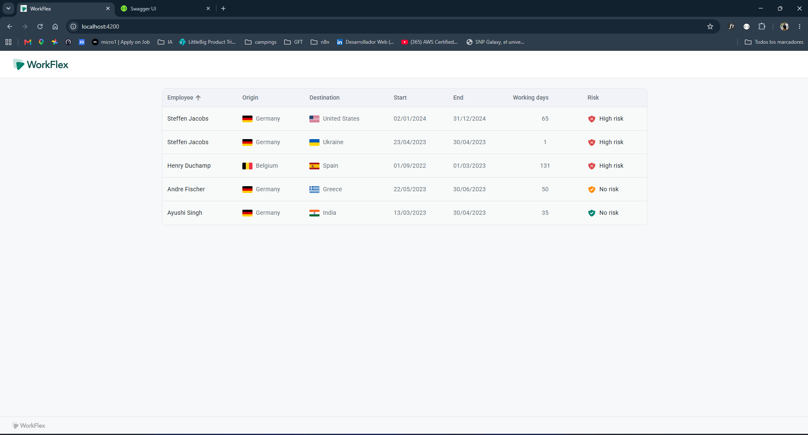

# WorkFlex – Workation Table

Workation table for the WorkFlex full-stack coding challenge: a Spring Boot API that imports workations from a CSV into an H2 database, and an Angular UI that shows them in a sortable table.



## Prerequisites

| Tool | Version |
|---|---|
| Java | 21 (e.g. Temurin) |
| Node.js | 24.19 |
| npm | 11 |

Maven is not required — the backend ships with the Maven wrapper.

## Running

**Backend** (http://localhost:8080):

```bash
cd backend
./mvnw spring-boot:run        # Windows: .\mvnw spring-boot:run
```

**Frontend** (http://localhost:4200) — start the backend first:

```bash
cd frontend
npm install
npx ng serve                  # or: ng serve, with a global Angular CLI
```

## Tests

```bash
cd backend && ./mvnw test                 # unit, @WebMvcTest slice, @SpringBootTest
cd frontend && npx ng test --watch=false  # Vitest
cd frontend && npx ng build               # production build
```

## API

| Method | Path | Description |
|---|---|---|
| `GET` | `/workflex/workation` | All workations, ordered by id |

```json
{
  "workationId": "w1",
  "employee": "Steffen Jacobs",
  "origin": "Germany",
  "originCode": "de",
  "destination": "United States",
  "destinationCode": "us",
  "start": "2024-01-02",
  "end": "2024-12-31",
  "workingDays": 65,
  "risk": "HIGH"
}
```

- Swagger UI: http://localhost:8080/swagger-ui.html
- H2 console: http://localhost:8080/h2-console — JDBC URL `jdbc:h2:mem:workflex`, user `sa`, empty password.
- Errors are returned as RFC 7807 `ProblemDetail` (`application/problem+json`).

## Architecture

### Backend — Spring Boot 4, Java 21, H2, Spring Data JPA

Package-by-feature, layered inside the feature; concerns that aren't specific to workations live at the top level:

```
com.hernanaguado.backend
├── config/        WebConfig — CORS for the frontend origin (from application.yaml)
├── country/       CountryCodeResolver — English country name → ISO alpha-2 code
├── exception/     GlobalExceptionHandler — @RestControllerAdvice → ProblemDetail
└── workation/
    ├── controller/   WorkationController — thin, HTTP mapping only
    ├── service/      WorkationService — read use case
    ├── repository/   WorkationRepository — Spring Data JPA
    ├── model/        Workation entity, RiskLevel enum
    ├── dto/          WorkationDto record (the entity is never exposed)
    ├── mapper/       WorkationMapper — entity → DTO, adds country codes
    ├── importer/     WorkationCsvParser + WorkationCsvImporter
    └── exception/    CsvImportException
```

- **CSV import:** `WorkationCsvImporter` is an `ApplicationRunner`. On startup it reads `classpath:workations.csv` (location configurable via `workflex.import.csv-location`), parses it with Apache Commons CSV and saves it. It only imports when the table is empty, so it is idempotent. Parsing is a separate component (`WorkationCsvParser`) so it can be unit-tested without Spring. Invalid rows (missing or empty fields, unknown risk, unparseable date or number) are skipped with a `WARN` log that includes the CSV line number; valid rows are still imported. Edge cases (quoted names with commas, countries like "Czechia" or "South Korea", unknown countries) are covered by `src/test/resources/workations-edge-cases.csv`.
- **Country codes** are derived at mapping time from the JDK's `Locale` data rather than stored, so the database keeps exactly what the CSV contains.
- Hexagonal/clean architecture was deliberately not used: for a single read-only endpoint, a layered feature package keeps the code easy to follow without extra ports and adapters.

### Frontend — Angular 22, standalone components, signals, Angular Material

```
src/app
├── app.*                         layout shell: header logo, router outlet, footer
└── features/workation/
    ├── workation.model.ts        interfaces matching the backend DTO
    ├── workation.service.ts      HTTP access (base URL from environment.ts)
    └── workation-table/          mat-table + matSort, loading / empty / error states
```

- The API base URL lives in `src/environments/environment.ts`; the browser calls the backend directly and the backend allows `http://localhost:4200` via CORS.
- Sorting uses `MatTableDataSource` with a custom `sortingDataAccessor`: risk sorts by severity (HIGH > LOW > NO) and dates sort chronologically (ISO strings), independent of the `dd/MM/yyyy` display format.

## Assumptions

- **Risk values:** the CSV uses `HIGH`, `LOW`, `NO`, while the PDF talks about `LOW_RISK` / `NO_RISK`. `RiskLevel.fromCsv` accepts both spellings, case-insensitively. As specified, both `LOW` and `NO` are labelled **"No risk"** in the UI, with a yellow and a green icon respectively.
- **Dates come from the CSV**, so a few differ from the PDF screenshot (e.g. w1 starts 02/01/2024 in the CSV vs 02/10/2024 in the screenshot; w4 starts 22/05/2023 vs 22/04/2023).
- **Client-side sorting:** the PDF allows either; with a handful of rows, sorting in the browser avoids a round trip per click.
- **Flags** are loaded from [flagcdn.com](https://flagcdn.com) using the ISO code from the API (emoji flags don't render on Windows). If a country can't be resolved, its code is `null` and only the name is shown.
- The import runs on every startup against an in-memory database; there is no create/update/delete API, as none was requested.

## Use of AI tooling

Developed with Claude Code as a pair programmer. [`CLAUDE.md`](CLAUDE.md) holds the project conventions and workflow rules (layering, testing, Spring Boot 4 specifics) the assistant followed. All generated code was reviewed, run and tested before being committed.

## What I'd do with more time

- Server-side pagination and sorting (`Pageable`) once the dataset can grow.
- A real database (PostgreSQL) with Flyway migrations, and Testcontainers for integration tests.
- End-to-end tests with Playwright covering sorting and hover behaviour in a real browser.
- Docker Compose to start backend and frontend with one command.
- Text filter on the table, and i18n for labels and date formats.
- Serve flag images locally instead of relying on a third-party CDN.